# Oracle HR Schema: SQL Analysis

A small SQL project on the HR sample schema that Oracle Database 11g installs by default. I wrote queries to explore the data, checked how the tables connect to each other, looked at the constraints in the data dictionary, and drew an ER diagram of the schema.

The HR schema and its data come with Oracle. What I wrote are the queries, the checks and this documentation.

**Tools:** Oracle Database 11g, Oracle SQL Developer, SQL Developer Data Modeler

## The schema

| Table | What it holds |
| --- | --- |
| EMPLOYEES | Employees, their job, salary, manager and department |
| DEPARTMENTS | Departments, their manager and location |
| JOBS | Job titles with minimum and maximum salary |
| JOB_HISTORY | Previous jobs of employees |
| LOCATIONS | Addresses and cities |
| COUNTRIES | Countries and their region |
| REGIONS | Regions |

The data has 107 employees and 27 departments.

## Files

```
sql/
  01_Database_Exploration.sql    table structure, row counts, basic join
  02_Employee_Analysis.sql       analysis queries (part 1 below)
  03_Database_Design.sql         constraints and foreign keys (part 2 below)
screenshots/                     query results and the ER diagram
README.md
```

---

## Part 1: Analysing the data

### Table structure and row counts

I started with `USER_TAB_COLUMNS` to see the columns and data types of EMPLOYEES (11 columns) and DEPARTMENTS (4 columns), then counted the rows in both tables.

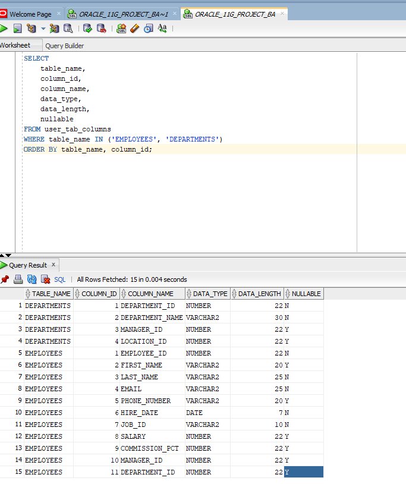
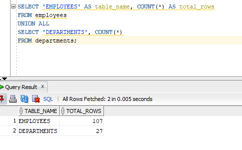

### Employees per department

A `LEFT JOIN` from DEPARTMENTS to EMPLOYEES, counting `e.employee_id` so that departments with nobody in them show 0 instead of disappearing.

Shipping is the biggest department with 45 employees, then Sales with 34. Finance and Purchasing have 6 each. Only 11 of the 27 departments have employees. The counts add up to 106, so one employee has no department at all (`DEPARTMENT_ID` is nullable in EMPLOYEES).

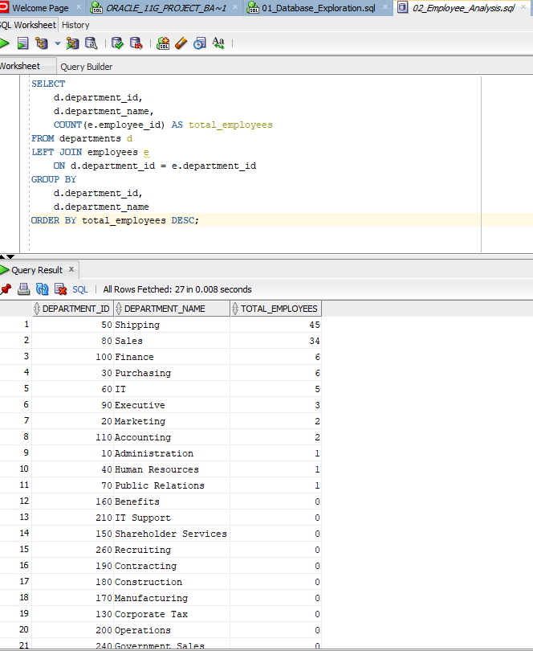

### Departments with no employees

The same join with `WHERE e.employee_id IS NULL` returns the 16 departments that have nobody assigned (Treasury, Corporate Tax, Benefits, Payroll and others).

```sql
SELECT d.department_id, d.department_name
FROM departments d
LEFT JOIN employees e ON d.department_id = e.department_id
WHERE e.employee_id IS NULL
ORDER BY d.department_id;
```

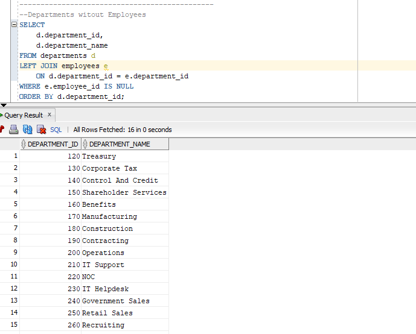

### Departments with more than 5 employees

`GROUP BY` with `HAVING COUNT(...) > 5`. HAVING filters after the grouping, WHERE filters rows before it, which is why the count can't go in a WHERE. Result: Shipping (45), Sales (34), Finance (6), Purchasing (6).

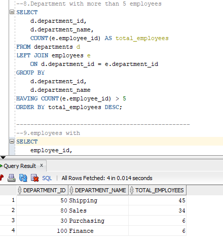

### Salary by department

Average, minimum and maximum salary per department with `AVG`, `MIN`, `MAX`, `COUNT` and `ROUND`.

- Executive has the highest average, 19,333.33 across 3 employees (range 17,000 to 24,000).
- Sales has 34 employees, average 8,955.88, range 6,100 to 14,000.
- Shipping has 45 employees and an average of 3,475.56.

The salary numbers are just the values in the sample data.

```sql
SELECT
    d.department_id,
    d.department_name,
    COUNT(e.employee_id) AS total_employees,
    MIN(e.salary) AS minimum_salary,
    MAX(e.salary) AS maximum_salary,
    ROUND(AVG(e.salary), 2) AS average_salary
FROM departments d
LEFT JOIN employees e
    ON d.department_id = e.department_id
GROUP BY
    d.department_id,
    d.department_name
ORDER BY average_salary DESC NULLS LAST;
```

`NULLS LAST` keeps the departments with no employees at the bottom, where the average is NULL.

### Employees earning above the average

A subquery calculates the average salary of the whole table and the outer query returns everyone above it. Steven King is at the top with 24,000, followed by Neena Kochhar and Lex De Haan with 17,000 each.

```sql
SELECT employee_id, first_name, last_name, salary
FROM employees
WHERE salary > (SELECT AVG(salary) FROM employees)
ORDER BY salary DESC;
```

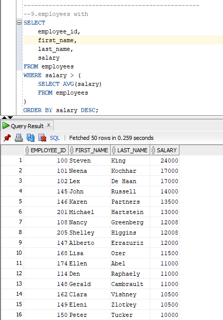

### Employees hired since 2000

Filtering on `HIRE_DATE >= DATE '2000-01-01'`, newest first. The most recent hires are Sundita Kumar and Amit Banda, both on 21 April 2008.

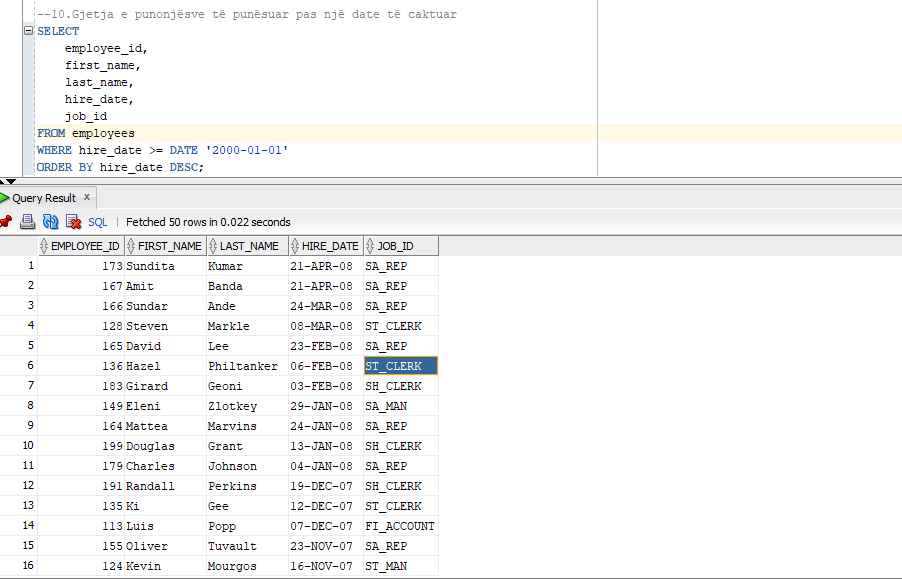

### Employees and salaries by job

Grouped by `JOB_ID` with count, average, minimum and maximum salary. There are 19 jobs. SA_REP is the most common with 30 employees (average 8,350), then ST_CLERK and SH_CLERK with 20 each. SA_MAN has an average of 12,200 across 5 people.

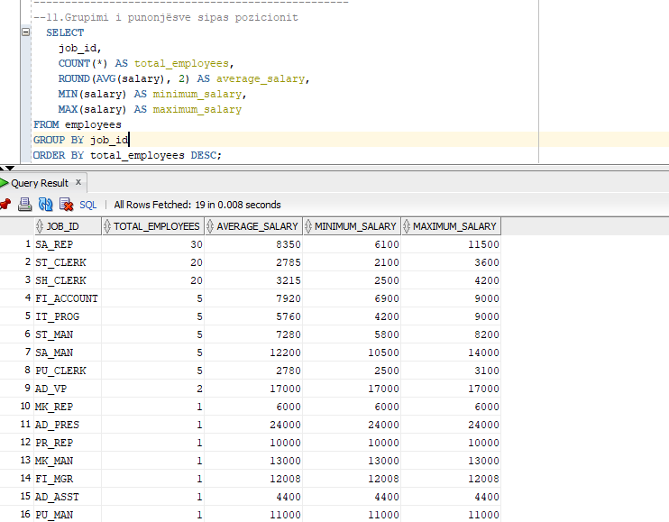

### Salary bands with CASE

I split salaries into four bands. The limits are my own choice, not an official classification.

| Band | Salary | Employees |
| --- | --- | --- |
| Low | below 4,000 | 42 |
| Medium | 4,000 to 7,999 | 29 |
| High | 8,000 to 11,999 | 27 |
| Very High | 12,000 and above | 9 |

```sql
SELECT
    CASE
        WHEN salary < 4000  THEN 'Low Salary'
        WHEN salary < 8000  THEN 'Medium Salary'
        WHEN salary < 12000 THEN 'High Salary'
        ELSE 'Very High Salary'
    END AS salary_category,
    COUNT(*) AS total_employees
FROM employees
WHERE salary IS NOT NULL
GROUP BY
    CASE
        WHEN salary < 4000  THEN 'Low Salary'
        WHEN salary < 8000  THEN 'Medium Salary'
        WHEN salary < 12000 THEN 'High Salary'
        ELSE 'Very High Salary'
    END
ORDER BY total_employees DESC;
```

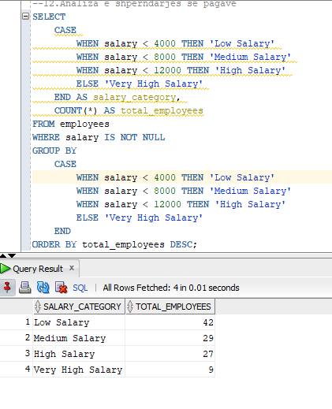

### Orphan check

Looks for employees whose `DEPARTMENT_ID` points to a department that doesn't exist (`LEFT JOIN`, `IS NOT NULL` on the employee side, `IS NULL` on the department side). It returned 0 rows. Part 2 shows the foreign key that guarantees this.

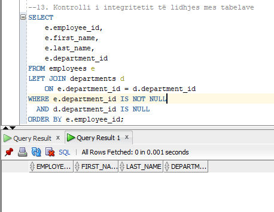

---

## Part 2: Constraints and ER diagram

### Primary and unique keys

I queried `USER_CONSTRAINTS` for the four main tables (EMPLOYEES, DEPARTMENTS, JOBS, LOCATIONS). It returned 11 constraints: four primary keys (`EMP_EMP_ID_PK`, `DEPT_ID_PK`, `JOB_ID_PK`, `LOC_ID_PK`), one unique key (`EMP_EMAIL_UK`) on the employee email, and six foreign keys. All are ENABLED.

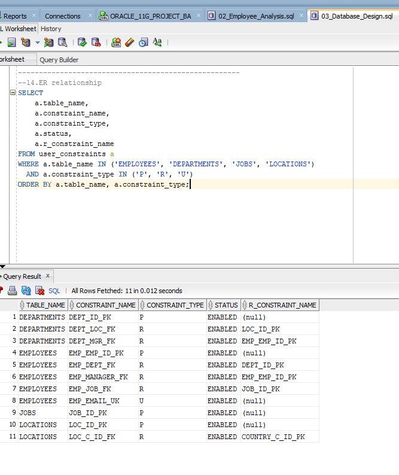

### Foreign keys

Joining `USER_CONSTRAINTS` with `USER_CONS_COLUMNS` twice gives each foreign key together with the column it references.

```sql
SELECT fk.constraint_name AS foreign_key,
       fk.table_name      AS child_table,
       fkc.column_name    AS child_column,
       pk.table_name      AS parent_table,
       pkc.column_name    AS parent_column
FROM user_constraints fk
JOIN user_cons_columns fkc
    ON fk.constraint_name = fkc.constraint_name
   AND fk.table_name = fkc.table_name
JOIN user_constraints pk
    ON fk.r_constraint_name = pk.constraint_name
JOIN user_cons_columns pkc
    ON pk.constraint_name = pkc.constraint_name
   AND pk.table_name = pkc.table_name
   AND pkc.position = fkc.position
WHERE fk.constraint_type = 'R'
ORDER BY fk.table_name, fk.constraint_name, fkc.position;
```

The schema has 10 foreign keys:

| Foreign key | Child table | Column | Parent table |
| --- | --- | --- | --- |
| COUNTR_REG_FK | COUNTRIES | REGION_ID | REGIONS |
| DEPT_LOC_FK | DEPARTMENTS | LOCATION_ID | LOCATIONS |
| DEPT_MGR_FK | DEPARTMENTS | MANAGER_ID | EMPLOYEES |
| EMP_DEPT_FK | EMPLOYEES | DEPARTMENT_ID | DEPARTMENTS |
| EMP_JOB_FK | EMPLOYEES | JOB_ID | JOBS |
| EMP_MANAGER_FK | EMPLOYEES | MANAGER_ID | EMPLOYEES |
| JHIST_DEPT_FK | JOB_HISTORY | DEPARTMENT_ID | DEPARTMENTS |
| JHIST_EMP_FK | JOB_HISTORY | EMPLOYEE_ID | EMPLOYEES |
| JHIST_JOB_FK | JOB_HISTORY | JOB_ID | JOBS |
| LOC_C_ID_FK | LOCATIONS | COUNTRY_ID | COUNTRIES |

`EMP_MANAGER_FK` points from EMPLOYEES back to EMPLOYEES. That is how the manager hierarchy is stored.

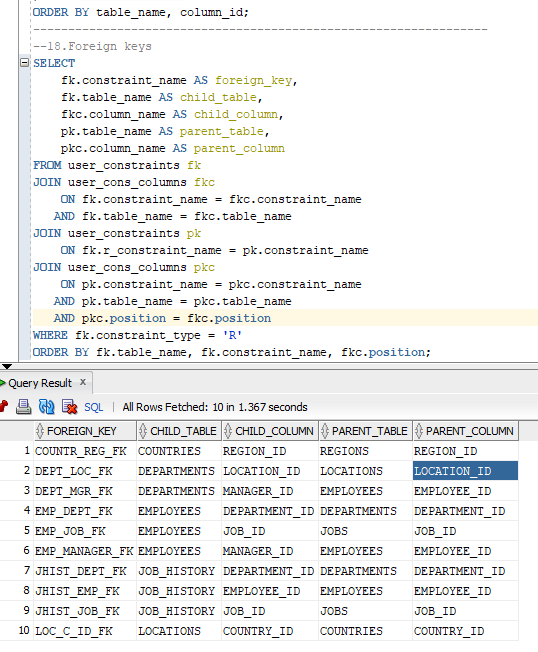

All 10 are ENABLED and VALIDATED, and every one uses the default delete rule NO ACTION, so a parent row can't be deleted while child rows still reference it.

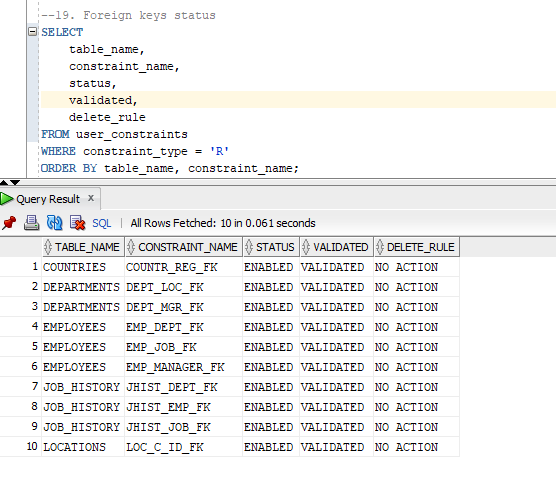

### ER diagram

I imported the schema into SQL Developer Data Modeler to get the diagram below.

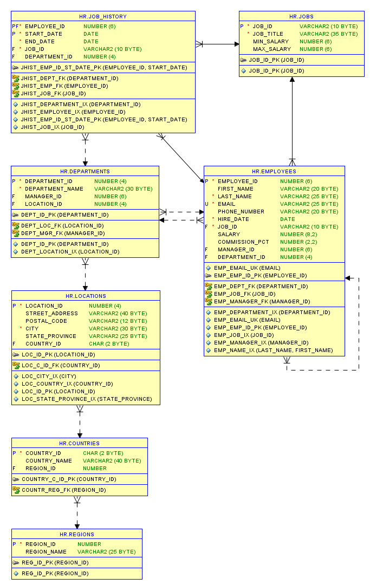

The import into Data Modeler picked up all 7 statements with no failures:

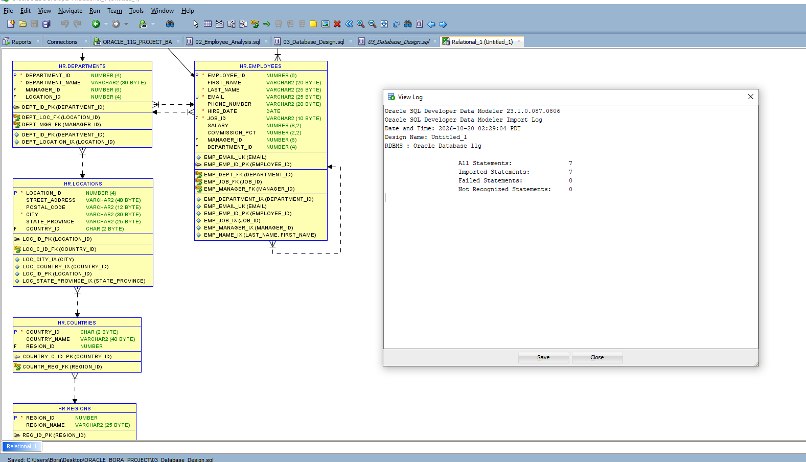

---

## How to run

1. Connect as the `HR` user in SQL Developer. If the account is locked, unlock it as an admin user: `ALTER USER hr ACCOUNT UNLOCK;`
2. Run the scripts in the `sql/` folder in order.

## What I practised

- Joins (`LEFT JOIN`, self-reference), `GROUP BY`, `HAVING`
- Aggregate functions, subqueries, `CASE`, date filtering
- Reading the Oracle data dictionary (`USER_TAB_COLUMNS`, `USER_CONSTRAINTS`, `USER_CONS_COLUMNS`)
- Reading and drawing a relational schema

*Author: Bora Abazaj*
